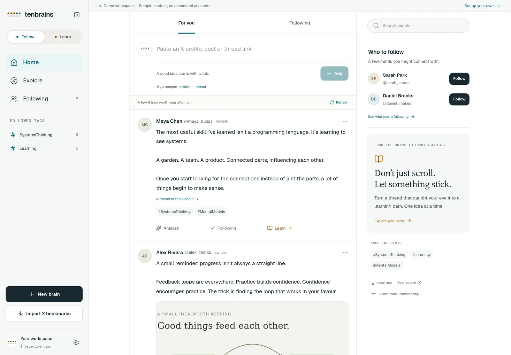
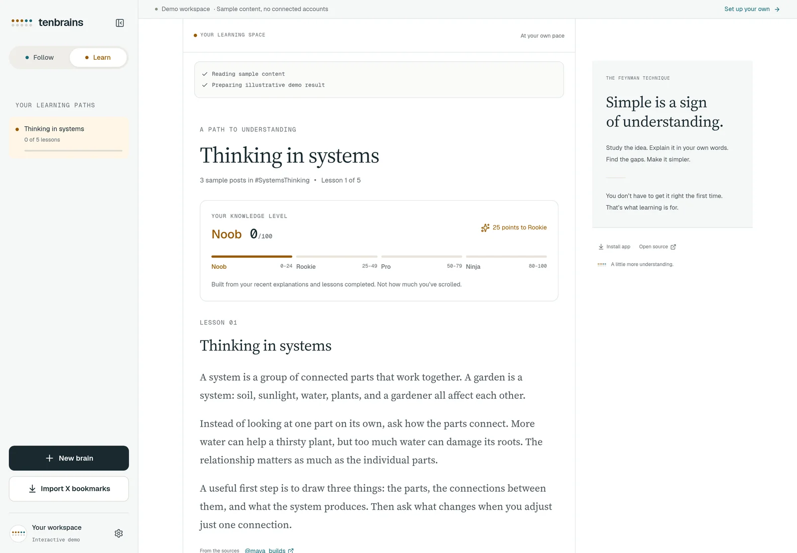
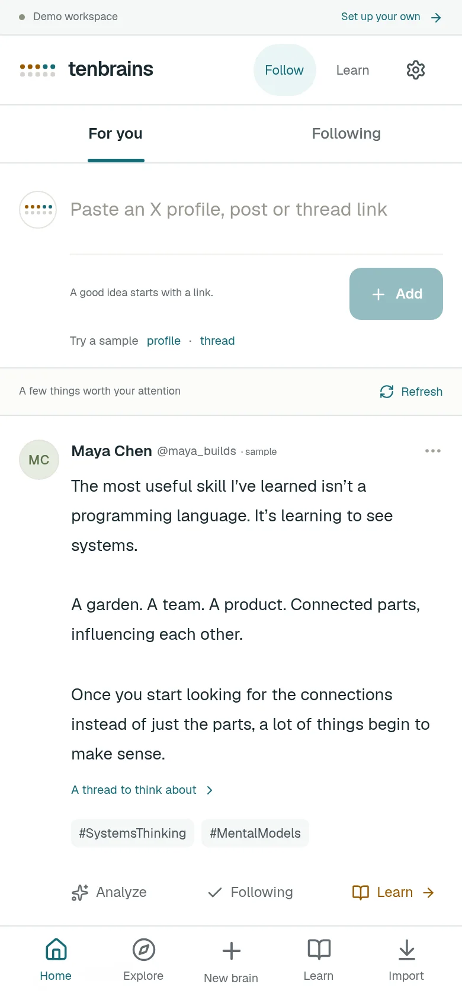
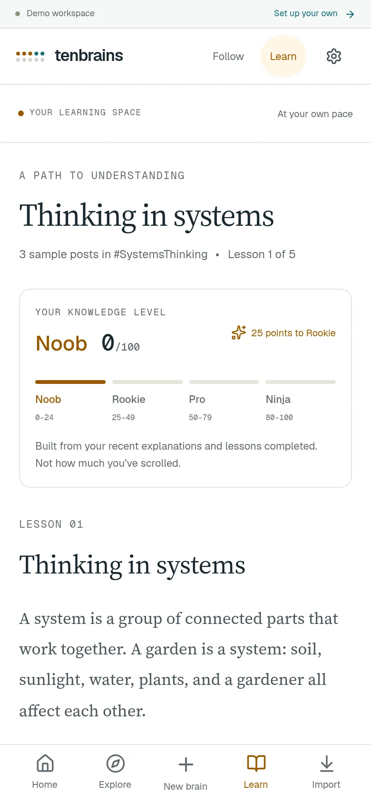
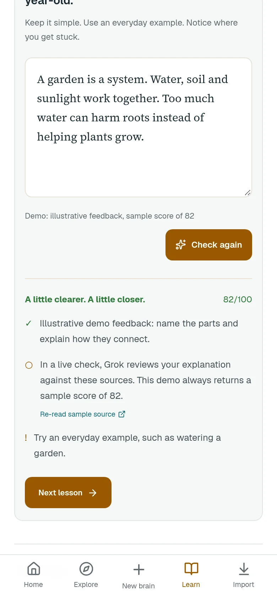

# tenbrains

**Follow your curiosity. Learn what matters.**

A personal, open-source workspace that turns X profiles, posts, threads, and bookmarks into a feed to **Follow** or a path to **Learn**. Built for Cloudflare Workers and D1, with Next.js App Router, TypeScript, Tailwind, and xAI's Grok.

[](https://deploy.workers.cloudflare.com/?url=https://github.com/moeghashim/tenbrains)

[Try the interactive demo](https://tenbrains.mohanadgh.workers.dev/demo/) · [Watch the demo video](docs/media/demo.mp4) · [Guided installation](#guided-installation-recommended)

## What it does

- Follow accounts and tags locally without changing who you follow on X.
- Add an X link with automatic profile/post/thread recognition. Thread counts reflect confirmed posts, not a promise of complete historical coverage.
- Import bookmarks read-only, in batches of up to 20. Never posts to X or writes bookmarks.
- Request text summaries and categorization using Grok with your own xAI API key. Images and videos are displayed, **not analyzed**.
- Create 5–7 cited lessons and work through them at your own pace. Explain an idea simply, receive source-grounded feedback, and revise it.
- Complete a lesson with an explanation scoring at least 70. Knowledge levels: Noob (0–24), Rookie (25–49), Pro (50–79), Ninja (80–100).
- Install the online-only PWA on a phone. No offline caching, synchronization, or background phone process is required.

Each deployment belongs to **one X account**. Other people fork the project and deploy their own copy. The public `/demo/` uses fictional sample accounts and illustrative AI results; it never accesses the owner's data or calls X or xAI, and resets when reloaded.

## Screenshots and demo

All screenshots and the video show fictional demo content. Grades and AI feedback are illustrative, not live Grok responses. Mobile captures use Chromium touch emulation, not a physical phone.

| Follow | Learn |
| --- | --- |
| [](docs/media/demo.mp4) |  |

<details>
<summary>Phone layouts and lesson feedback</summary>

| Follow on mobile | Learn on mobile | Explanation feedback |
| --- | --- | --- |
|  |  |  |

</details>

[Watch or download the demo video (MP4, 17 seconds)](docs/media/demo.mp4). It shows account details, post analysis, switching to Learn, entering an explanation, and illustrative feedback. The [media files](docs/media) are included in the repository.

## Try it locally

Use Node **24.15.0** (see `.node-version`) and npm **12.2.1**. This Node version supports the native SQLite test harness.

```sh
npx --yes npm@12.2.1 ci
npm run db:migrate
npm run preview
```

Open the local address printed by Wrangler, then `/demo/`. No credentials are needed for the demo. The home screen explains setup; it never silently signs you in or falls back to fake data.

For live local integration, copy `.dev.vars.example` to `.dev.vars`, set `APP_URL=http://localhost:8787`, configure the credentials described below, and set the matching local X callback. Never commit `.dev.vars`. `npm run dev` provides fast Next.js UI development only; `npm run preview` runs the real Worker API and D1 alongside the built interface.

## Deploy your own to Cloudflare

You need a Cloudflare account, an X developer app with API access/credits, and an [xAI API key](https://console.x.ai/) for Grok. xAI API usage is billed separately from X API access and consumer Grok subscriptions. A custom domain is optional; a `workers.dev` HTTPS address works for the PWA.

### Guided installation (recommended)

Click **Deploy to Cloudflare** above. Cloudflare guides you through connecting GitHub/GitLab, creating your own repository and Worker, provisioning a **new D1 database**, and entering configuration and secrets. It writes your new database ID into your copy of `wrangler.jsonc`; your installation does not share the original deployment's database or credentials.

1. Choose names for your repository, Worker, and database. Keep the D1 binding name `DB` even if you rename the database.
2. Enter your X client ID and secret, numeric owner X ID, xAI API key, and a new random `SESSION_SECRET` of at least 32 characters. Generate that secret locally with `openssl rand -hex 32`. `TOKEN_ENCRYPTION_KEY` and `XAI_MODEL` are optional; the form explains each field. Never reuse an example secret or paste keys into a Git commit.
3. Accept the detected build/deploy commands. The deploy script builds the static app, applies pending migrations to the bound remote database, and deploys the Worker. Migrations use the binding `DB`, so renamed databases work too.
4. After deployment, set `APP_URL` to the **exact HTTPS origin** in Worker Settings → Variables and Secrets. If you knew the final address during setup, verify it matches. Register that origin plus `/auth/callback` in your X application as described below, then sign in with your owner account.

This is a guided installation, not zero-configuration: Cloudflare cannot create your X developer app or xAI account, register the X callback, or generate your personal API credentials. If configuration is incomplete, the app safely shows setup instructions and the public demo remains available. See the configuration table below for all fields.

Cloudflare's template flow creates cloud resources and runs remote migrations. Review the [free-tier limits and API costs](#usage-and-cost-controls) before deploying. Subsequent deployments also apply pending migrations automatically. The repository must be public for others to use this button.

### Manual installation

If you prefer the CLI, use the following steps instead. Both installation methods share the X, secret, and phone-installation steps below.

### 1. Fork and install

Fork this repository, clone your fork, then run:

```sh
npx --yes npm@12.2.1 ci
npx wrangler login
```

### 2. Create the database

```sh
npx wrangler d1 create tenbrains
```

Replace `database_id` in `wrangler.jsonc` with the returned ID. Forks must use their own database, not the ID checked into this repository. Keep the binding name `DB` and database name `tenbrains`.

The following commands **write to your cloud account and production database**. Run them deliberately:

```sh
npm run deploy
```

`npm run deploy` builds the app, applies pending migrations to the remote `DB` binding, and deploys it. The first deployment safely shows setup instructions until credentials are configured. Note its HTTPS address. For migrations without deploying, use `npm run db:migrate:remote`.

### 3. Configure your X application

In the [X developer console](https://console.x.com/), enable OAuth 2.0 for a Web App/confidential client. Set the exact callback to:

```text
https://YOUR-APP-ADDRESS/auth/callback
```

Set its website URL to your app's origin. Obtain the client ID and client secret. Find **your numeric X user ID** (not your handle); this becomes the owner allowlist. Do not enable writes for this app. The requested scopes are:

```text
tweet.read users.read follows.read bookmark.read offline.access
```

`offline.access` allows the **server** to refresh its X authorization; it does not mean the PWA works offline. X requires API access and may charge for reads. Review [current X API pricing](https://docs.x.com/x-api/getting-started/pricing) before enabling automatic refreshes.

### 4. Add server-side configuration

Use **Workers & Pages → tenbrains → Settings → Variables and Secrets**, or the interactive CLI commands below. Do not put keys in browser code, Git, screenshots, or chat.

```sh
npx wrangler secret put APP_URL
npx wrangler secret put OWNER_X_ID
npx wrangler secret put X_CLIENT_ID
npx wrangler secret put X_CLIENT_SECRET
npx wrangler secret put SESSION_SECRET
npx wrangler secret put XAI_API_KEY
```

| Setting | Value |
| --- | --- |
| `APP_URL` | Exact HTTPS origin, e.g. `https://tenbrains.example.com`, with no path/query |
| `OWNER_X_ID` | Your numeric X account ID; all other accounts are rejected |
| `X_CLIENT_ID`, `X_CLIENT_SECRET` | Your app's OAuth 2.0 credentials |
| `SESSION_SECRET` | A cryptographically random secret of at least 32 characters; generate locally with `openssl rand -hex 32` |
| `XAI_API_KEY` | Your key from the [xAI console](https://console.x.ai/) for Grok |
| `XAI_MODEL` (optional) | Defaults to [`grok-4.3`](https://docs.x.ai/developers/models/grok-4.3); must support [xAI structured outputs](https://docs.x.ai/developers/model-capabilities/text/structured-outputs) |
| `TOKEN_ENCRYPTION_KEY` (optional) | Separate random secret for encrypting X tokens; otherwise a purpose-separated key is derived from `SESSION_SECRET` |

Changing the token encryption secret makes stored X authorization unreadable until you sign in again. Changing the session secret invalidates existing sessions and pending sign-ins.

Existing installations must configure `XAI_API_KEY` before using AI actions; previous provider keys are not compatible. No library migration or X reauthorization is required for this AI-provider change.

Sign in with X using your allowlisted account. Add a profile, then refresh the feed. Use Analyze or Learn when you want to call Grok. Model-generated feedback is an aid to learning, not an authoritative assessment.

### 5. Install on your phone

- **iPhone/iPad:** open the deployed HTTPS site in Safari → Share → **Add to Home Screen**.
- **Android:** open it in Chrome → **Install app** / **Add to Home screen**.

The app includes standalone display metadata, regular and maskable PNG icons, and an Apple touch icon. Installation prompts depend on the browser. It needs an internet connection; there is deliberately no offline service worker or cached private content.

## Usage and cost controls

The hourly Cron Trigger rotates through at most **three followed sources per refresh**, with a 55-minute throttle shared by manual and scheduled refreshes. Account requests fetch up to five posts; tag requests search actual X hashtags and fetch up to ten. That is at most 30 returned posts per refresh, not a spending cap. X controls billing, deduplication, permissions, and rate limits. Remove the cron from `wrangler.jsonc` before deployment if you want manual refresh only.

Automatic refresh never calls Grok. Adding a post/thread, importing bookmarks, Analyze, Learn, and Check explanation are explicit AI actions. xAI receives the selected source text and, for grading, your explanation. Progress is streamed from our server; this app requests complete structured JSON responses from Grok and validates them before saving. It does not stream model tokens.

Related-reading suggestions currently use posts already saved in your library, not fresh discovery across X. The API loads the whole library state; individual database rows are normalized, but very large libraries will eventually need paginated reads.

Cloudflare's free tier may cover personal usage, but the Worker Free CPU limit is strict. Paid Workers starts at US$5/month before overages; X API, xAI API, and an optional domain are separate. This app has not been benchmarked against a production free-tier account. See [Workers limits](https://developers.cloudflare.com/workers/platform/limits/) and [D1 pricing](https://developers.cloudflare.com/d1/platform/pricing/).

## Security and data

- Only the configured X owner can sign in. API routes require a revocable server-side session.
- OAuth uses PKCE, a state check, encrypted HttpOnly cookies, and Secure cookies on HTTPS. Mutations require an exact Origin match.
- X tokens are encrypted before persistence. Secrets are never returned in the app state.
- Source content is treated as untrusted input. AI outputs are schema-checked and citations must refer to supplied source IDs.
- Concurrent updates use version checks rather than silently overwriting newer data. On a conflict, reload before retrying an action that may cost money.
- Keep imported content private. Follow X's developer terms, content retention/deletion rules, and applicable privacy requirements. Open-sourcing the code does not grant rights to redistribute imported posts.
- The demo is public; personal content is not. D1 and your Cloudflare account contain your library and learning history. Secure your Cloudflare account and manage backups there.

## Development and checks

```sh
npm run typecheck
npm test
npm run build
npx wrangler deploy --dry-run
```

With the built Worker preview running, `npm run test:e2e` checks the demo workflows, narrow-screen layout, and Chromium PWA installability. Orbs reuse their preinstalled agent-browser Chromium; elsewhere run `npx playwright install chromium` first, or set `CHROME_PATH` to an existing Chromium executable. These are browser-emulation checks, not tests on a physical phone.

Tests exercise the Worker API with real SQLite and controlled X/xAI HTTP fixtures. They do **not** prove live credentials, X permissions, or AI grading quality. Real-service acceptance checks should use a personal test account and explicit API budgets.

### Amp orbs

`.agents/setup` installs the pinned Node release (verifying the official checksum), reuses dependency caches, applies **local-only** D1 migrations, and builds static assets. It is idempotent and requires no user authentication or secrets. `.agents/resume` is deliberately fast and never installs packages.

```sh
amp orb services ensure
```

This starts the declared supervised Worker preview and prints an accessible demo portal. After UI changes, run `npm run build` followed by `amp orb service restart web` so the preview picks up new hashed asset paths. Wrangler reloads Worker code automatically. Setup only becomes active for future project orbs after its commit reaches the default branch.

## License

MIT — see [LICENSE](LICENSE).
